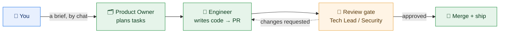
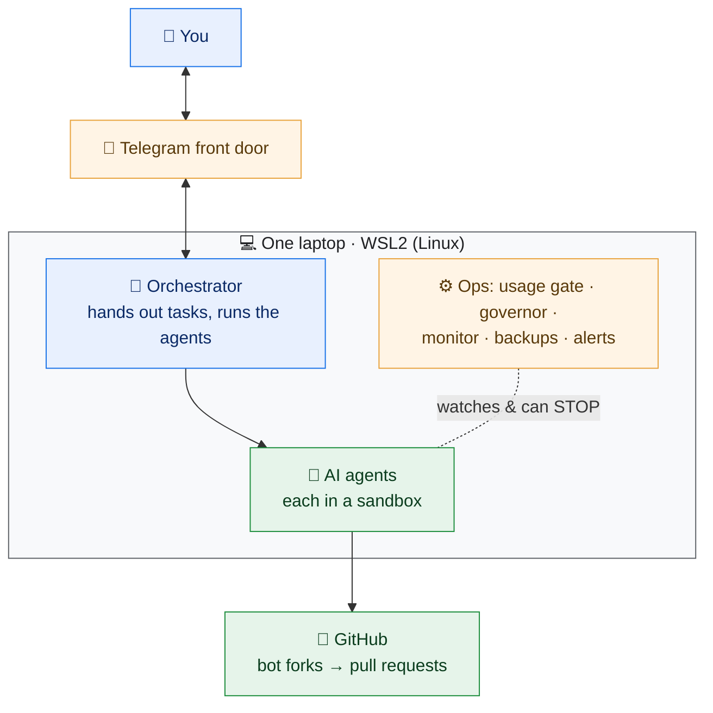
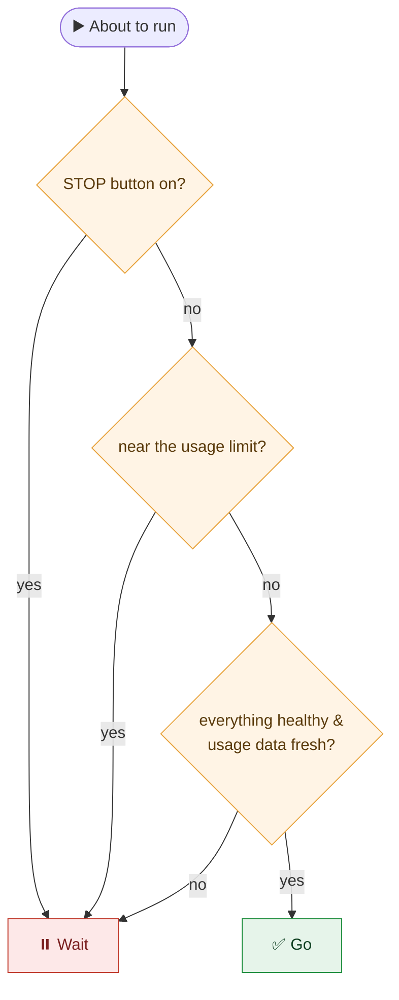
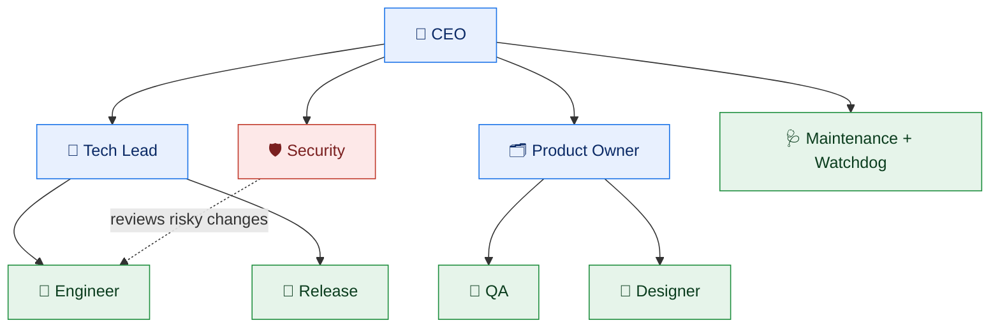

# Paperclip AI Company 🏢🤖

> **A small AI "software team" that runs on one laptop — built, and proven end‑to‑end.**
> It plans features, writes the code, reviews its own work, and ships — safely, and without
> surprise bills.

This isn't a "what if." It's running. A 10‑role AI company planned a feature, an engineer built it,
a reviewer approved it, and it merged and served — on a single laptop, with **zero** surprise spend.

---

## What is this? (the 30‑second version)

Instead of chatting with **one** AI assistant, you get a small **team** of AI "employees" — a product
owner, engineers, a tester, a reviewer, a security checker — each with a job. You drop a brief; they
turn it into tasks, write the code, **review each other's pull requests**, and ship the safe ones. It
all runs on **one normal laptop**, stays within a **fixed budget**, and **can't touch anything it
shouldn't**.



---

## It actually works (the proof)

In a first full end‑to‑end run, with **no human touching the keyboard**:

1. The **Product Owner** took a one‑line brief ("add a *How It Works* page") and broke it into a task.
2. The **Engineer** built it — a real page, with a test — and opened a pull request.
3. The build's tests went green; the **merge‑bot opened a review task** for the **Tech Lead**.
4. The Tech Lead **read the diff and approved it** (`REVIEW‑APPROVED`).
5. The change **merged** and the page was **served** locally.

Round trip: a few minutes, start to finish. You can also just **text the company from your phone** —
ask for status, or send a brief and it files a task to the CEO.

---

## How it works (4 steps)

1. 📝 **You send a brief** ("add a login page") — by chat or onto a task list.
2. 🧩 **The Product Owner turns it into small tasks** and assigns an engineer.
3. 🔀 **The engineer writes the code and opens a pull request**, which a **reviewer must approve**.
4. ✅ **Approved + tests green → it merges.** Anything risky or big waits for you.

You set direction and approve the big calls; the team does the typing *and* the reviewing.

---

## Why it's different

- 💻 **Runs on one laptop.** No cloud, no servers, no monthly hosting bill.
- 💸 **Never overspends.** A hard check stops it *before* it would cost money — it kept paid spend at
  **zero** the whole time. Leave it running.
- 👥 **A real team, not a chaotic swarm.** 10 roles, each with one job and a manager — [meet the team](docs/TEAM.md).
- 🧭 **Every change is reviewed.** An AI Tech Lead (or Security, for risky changes) reads the diff and
  signs off before anything merges — a review *gate*, not a rubber stamp.
- 🎓 **Domain experts on demand.** For a brief that needs more than software skill — mental health,
  nutrition, finance, policy — leadership proposes which expert roles the project needs, you switch
  those seats on, and they write the project's knowledge pack and **review the content** the same way
  the Tech Lead reviews the code. [How it works](docs/TEAM.md#domain-experts-on-demand).
- 🔒 **Safe by default.** Sandboxed agents, hidden secrets, a locked‑down machine; they propose, you (or
  safe rules) approve.
- 🎛️ **You stay in control.** A big "stop" button, and a Telegram front door to drive it from your phone.

👉 Fuller story: [**Why this one is different**](docs/WHY-DIFFERENT.md) · the backstory: [**The article**](docs/ARTICLE.md).

---

## Build your own

You don't need to be an expert — and you can hand most of it to an AI coding tool (like Claude Code)
to execute step by step.

1. Read the [**build‑your‑own guide**](docs/BUILD-YOUR-OWN.md) — a complete, ordered plan.
2. Scaffold a folder:
   ```bash
   ./scripts/scaffold.sh my-ai-company
   ```
3. Open `company.yaml`, fill in the blanks, and start with **one** teammate and **one** task.

Helpful files:
- 🧩 [`examples/company.yaml`](examples/company.yaml) — the one settings file, as a template.
- 🚦 [`examples/usage-gate.sh`](examples/usage-gate.sh) — the "don't overspend" safety check, explained.

---

## Is it safe?

Short answer: **yes — that's the whole point.**

- It **can't spend money you didn't agree to** — a built‑in check stops it first (it kept spend at zero).
- Each AI teammate works in a **locked box** — no web unless allowed, and it can't read your secrets.
- Agents **never get the keys** to your real code — they work on a **fork** and propose changes.
- **Every merge needs a review** — the AI Tech Lead/Security must approve the diff first.
- There's a **STOP button** that halts everything instantly.

---

<details>
<summary>🔧 <b>For the curious: how it looks under the hood</b> (click to expand)</summary>

You can skip this — it's here for people who want the technical picture.

**The pieces on the laptop**



**The "don't overspend" gate** (it refuses to run if anything looks off — this is why spend stayed at zero)



**The team** (the real org chart)



Full write‑ups: [`docs/ARTICLE.md`](docs/ARTICLE.md) and [`docs/BUILD-YOUR-OWN.md`](docs/BUILD-YOUR-OWN.md).

</details>

---

## Honest limitations

- The cheap **pay‑per‑token lane** (for high‑volume or background agents) needed a **second agent
  runtime**: the Claude‑Code harness only speaks the Anthropic model protocol, so non‑Anthropic models
  run through an OpenAI‑protocol harness (OpenCode) behind the budget proxy, in a filesystem jail. It
  works, but it is a second thing to keep patched, and those agents get full network egress unless you
  add a filtering proxy.
- **Domain experts are stand‑ins, not credentials.** For health, finance or legal topics the setup
  requires a real practitioner's sign‑off before anything is "done (deployed)". The expert agents
  prepare that review; they don't replace it.
- The Telegram front door runs a separate agent tool; on machines with strict app‑control it needs a
  signed build (see the build guide's gotchas).

---

## What's *not* in this repo (your privacy)

This is a public explainer — **documentation, not the runtime**. It has **no secrets and no personal
data**: no tokens, no emails, no account names, no file paths, no real project code. Just the idea, a
settings template, and a couple of scripts. Keep real secrets in a vault, **never in a repo**.

---

## License

[MIT](LICENSE) — free to use, copy, and change. No warranty.

> The question was: *can a small AI "company" run safely and cheaply on one laptop — and actually ship?*
> This repo is the sanitized answer. It can, and it did.
