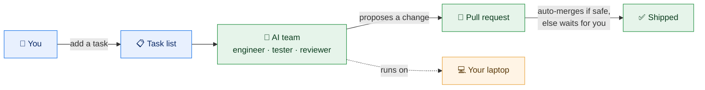
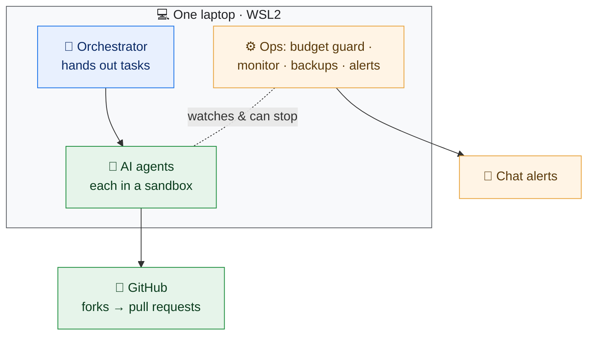
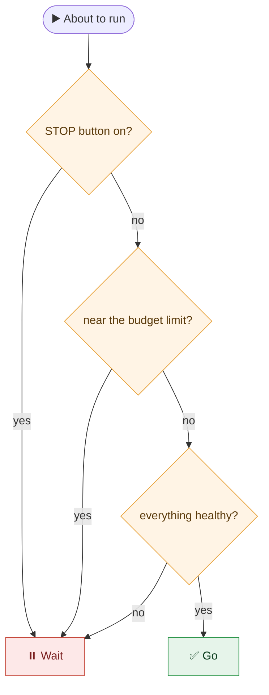
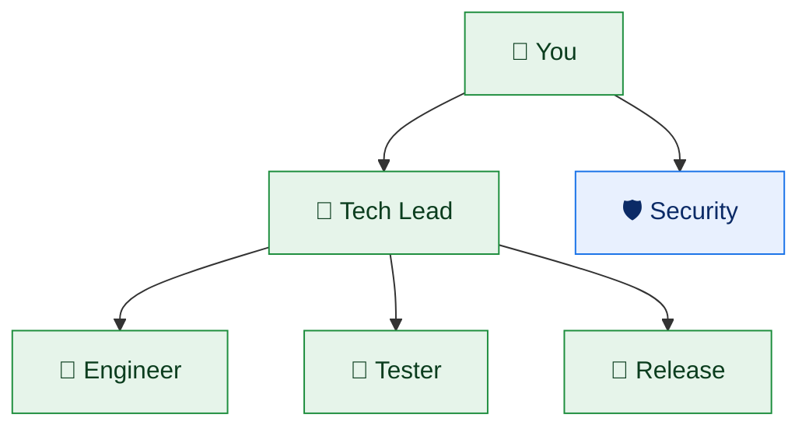

# Paperclip AI Company 🏢🤖

> **A little AI "software team" that runs on your own laptop.**
> It picks up tasks, writes the code, and hands you finished changes to approve — safely,
> and without surprise bills.

---

## What is this? (the 30‑second version)

Instead of chatting with **one** AI assistant, you get a small **team** of AI "employees" — an
engineer, a tester, a reviewer — each with a job. You drop tasks on a list; they do the work and
hand you pull requests (proposed changes) to approve. It all runs on **one normal laptop**, stays
within a **fixed budget**, and **can't touch anything it shouldn't**.



---

## How it works (4 steps)

1. 📝 **You add a task** to a list ("add a login page").
2. 🤖 **An AI teammate picks it up** and does one small job.
3. 🔀 **It opens a pull request** — a proposed change you can see.
4. ✅ **If it's small and the tests pass, it merges automatically.** Otherwise it waits for you.

That's it. You review and approve; the team does the typing.

---

## Why it's different

- 💻 **Runs on one laptop.** No cloud, no servers, no monthly hosting bill.
- 💸 **Never overspends.** It stops *before* it would cost you money — you can leave it running.
- 👥 **A real team, not a chaotic swarm.** Each AI has a clear role and knows its lane — [meet the team](docs/TEAM.md).
- 🔒 **Safe by default.** Sandboxed, can't leak your secrets, can't break your repo.
- 🎛️ **You stay in control.** A big "stop" button, and anything risky always waits for a human.

👉 Want the fuller story? Read [**Why this one is different**](docs/WHY-DIFFERENT.md) (a 2‑minute read).

---

## Try it / build your own

You don't need to be an expert.

1. Read the short [**build‑your‑own guide**](docs/BUILD-YOUR-OWN.md).
2. Run the starter script to create your own folder:
   ```bash
   ./scripts/scaffold.sh my-ai-company
   ```
3. Open `company.yaml`, fill in the blanks, and start with **one** teammate and **one** task.

Helpful files:
- 🧩 [`examples/company.yaml`](examples/company.yaml) — the one settings file, with blanks to fill in.
- 🚦 [`examples/usage-gate.sh`](examples/usage-gate.sh) — the "don't overspend" safety check, explained.

---

## Is it safe?

Short answer: **yes, that's the whole point.**

- It **can't spend money you didn't agree to** — a built‑in check stops it first.
- Each AI teammate works in a **locked box** — no web unless allowed, and it can't read your passwords.
- Agents **never get the keys** to your real code — they propose changes; you (or safe auto‑rules) approve.
- There's a **STOP button** that halts everything instantly.

---

<details>
<summary>🔧 <b>For the curious: how it looks under the hood</b> (click to expand)</summary>

You can skip this — it's here for people who want the technical picture.

**The pieces on the laptop**



**The "don't overspend" check** (it refuses to run if anything looks off)



**The team**



Want the full technical write‑up? It's in [`docs/ARTICLE.md`](docs/ARTICLE.md) and
[`docs/BUILD-YOUR-OWN.md`](docs/BUILD-YOUR-OWN.md).

</details>

---

## What's *not* in this repo (your privacy)

This is a public explainer. It has **no secrets and no personal data** — no tokens, no emails, no
account names, no file paths, no real project code. Just the idea, a settings template with blanks,
and a couple of simple scripts. Keep your real secrets in a safe place, **never in a repo**.

---

## License

[MIT](LICENSE) — free to use, copy, and change. No warranty.

> Built as a weekend experiment: *can a small AI "company" run safely and cheaply on one laptop?*
> This repo is the friendly, sanitized answer.
