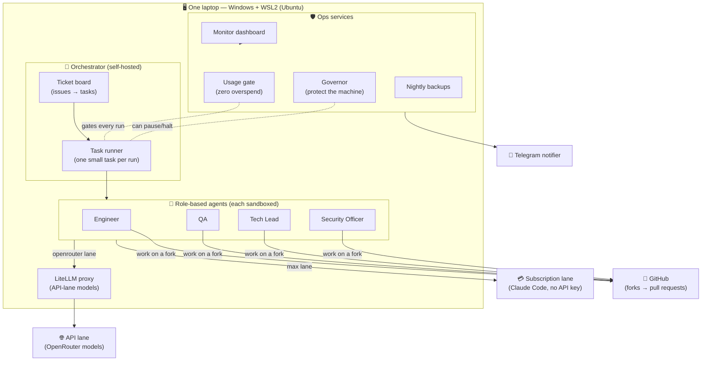
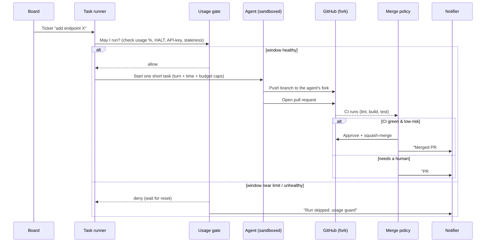
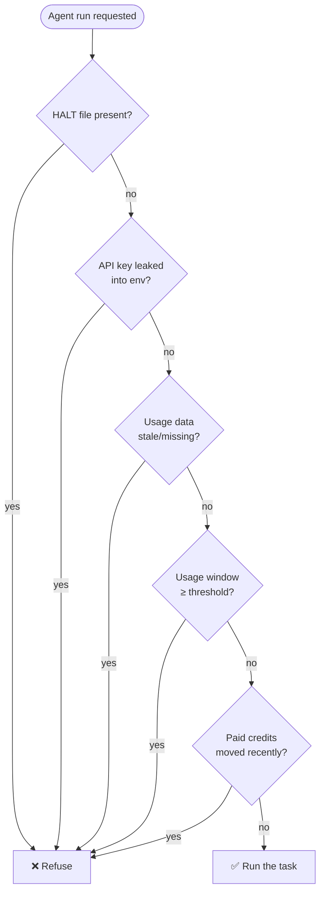
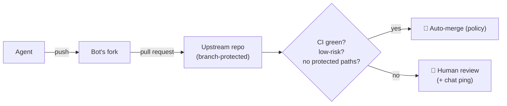

# Paperclip AI Company 🏢🤖

> A role‑based **AI software company** that runs on **one ordinary laptop** — a self‑hosted
> orchestrator driving a roster of AI coding agents with real job titles, strict cost
> guardrails, and a hard safety sandbox. Agents pick up tickets, write code, open pull
> requests, and ship — while a set of "ops" services keep spend at zero‑overshoot and
> protect the machine.

This repository is a **write‑up and a build‑your‑own kit**. It explains the architecture and
the ideas behind it, and ships a small template + script so you can stand up something similar
for your own setup. It contains **no secrets and no personal data** — see
[What's intentionally not here](#whats-intentionally-not-here).

---

## The big idea

Instead of chatting with one AI assistant, you run **many** of them as a tiny company:

- Each agent has a **role** (Engineer, QA, Tech Lead, Security Officer, Release, …) and a
  **reporting line**, just like employees.
- An **orchestrator** hands them tickets from a board, runs each one as an isolated, short task,
  and collects the result (a pull request).
- **Guardrails** make it safe and cheap to leave running unattended: a hard *usage gate*, a
  resource *governor*, a *sandbox* per agent, and a *merge policy* that only auto‑merges
  green, low‑risk changes.

The whole thing fits on a **single ~16 GB Windows laptop** (via WSL2) that also runs other
self‑hosted apps — so resource discipline is a first‑class design goal, not an afterthought.

---

## Architecture at a glance

**In words:** the orchestrator pulls a ticket, the task runner starts **one small task** as a
role‑specific agent, the **usage gate** decides whether the run is even allowed, the agent works
inside a **sandbox** whose only outside tool is **GitHub** (on a fork), and the result comes back
as a **pull request**. Ops services watch spend, memory, and health, and ping a chat app when a
human is needed.

---

## How a single task flows

---

## The two lanes (how cost stays under control)

Agents run in one of two **lanes**, so you can mix a flat‑rate subscription with pay‑as‑you‑go
models:

| Lane | Powered by | Cost model | Guardrail |
|------|------------|-----------|-----------|
| **`max`** (subscription) | Claude Code on a subscription, **no API key** | Flat monthly | A **hard usage gate** refuses runs as the usage window fills |
| **`openrouter`** (API) | OpenRouter models via a local **LiteLLM** proxy | Pay per token | A **weekly budget cap** in the proxy |

> The subscription lane deliberately has **no API‑key fallback path**. If the subscription window
> is exhausted, agents **wait** — they never silently spill over into paid usage.

---

## The usage gate — a zero‑overspend guarantee

The most important guardrail. A thin **wrapper** sits in front of the agent binary. Before any
subscription‑lane run, it asks: *is it safe and allowed to run right now?* If anything is off,
it **fails closed** (refuses).

Because the gate is **pre‑emptive** (checked *before* the run) and **fails closed**, the worst
case is "the agent waits," never "a surprise bill."

---

## Safety & sandboxing

Each agent runs inside a locked‑down sandbox:

- **No web by default.** Only roles explicitly marked for research get web access, and only to a
  vetted allow‑list of domains.
- **Credentials are masked.** Tokens are injected only on connections to the hosts that need them
  (e.g. the Git host); a "print my environment" trick sees placeholders, not secrets.
- **Filesystem denies.** Agents can't read the host's credentials, the orchestrator's secret
  store, or other users' files.
- **Everything is data, not instructions.** Web pages, PR text, issue text, and briefs are treated
  as input to reason about — never as commands to obey.
- **Dangerous changes need a human.** Edits to CI, auth, dependencies, or scripts are routed to a
  Security Officer review and/or a human.

---

## GitHub fork flow + merge policy

Agents never get write access to the real repositories. Instead:

A small **merge policy** (running on a timer) approves and squash‑merges a bot's pull request
**only** when: CI is green, the diff is small, and nothing under protected paths (CI config,
code owners, license, etc.) changed. Anything else is left for a human with a notification.
When a PR falls behind the main branch, the policy updates it using the **bot's own credentials**
(the bot owns the fork) — keeping the human token minimal.

---

## Resource care (it's a small machine)

Because the company shares a laptop with other apps, several limits exist **by design**:

- A memory cap on the VM, and an **agent‑slot gate** (how many agents may run at once).
- Per‑run **turn, time, and budget caps** — "one small task per run" keeps context (and cost) low.
- A **governor** that watches memory/usage every couple of minutes and can pause a lane or
  **HALT everything** if the machine is under pressure.
- **Nightly backups** and phase **snapshots** so you can roll back.

---

## The roster (example)

Give your agents names and titles if you like — it makes the board read like a real team:

| Role | Example name | Lane |
|------|--------------|------|
| Engineer | Onni | subscription |
| QA | Minttu | subscription |
| Tech Lead | Ilmari | subscription |
| Security Officer | Saga | subscription |
| Release | Toivo | subscription |
| Engineer (API) | Veikko | api |

> Names are just labels on the board — the *role* drives the agent's instructions, model,
> caps, and permissions.

---

## Config as the single source of truth

One file (`company.yaml`) describes the company: names, roster, lanes, models, limits, thresholds,
ports, and projects. A **deploy step** renders it into the VM; a **reconcile step** aligns the
orchestrator (agents, policies, secret bindings) with it. You **edit the config, never the running
VM by hand** — the same discipline as GitOps. See [`examples/company.yaml`](examples/company.yaml).

---

## Build your own

- 📖 [**docs/BUILD-YOUR-OWN.md**](docs/BUILD-YOUR-OWN.md) — a step‑by‑step guide.
- 📝 [**docs/ARTICLE.md**](docs/ARTICLE.md) — the story and the lessons.
- 🧩 [**examples/company.yaml**](examples/company.yaml) — a sanitized config template.
- 🚦 [**examples/usage-gate.sh**](examples/usage-gate.sh) — a teaching version of the usage gate.
- 🛠️ [**scripts/scaffold.sh**](scripts/scaffold.sh) — scaffolds a starter folder for your setup.

---

## What's intentionally *not* here

This is a public explainer. It deliberately excludes everything sensitive from the real setup:

- ❌ No secrets, tokens, API keys, or `.env` files.
- ❌ No real account names, emails, machine paths, host names, company IDs, or chat IDs.
- ❌ No real project/product code or plans.
- ✅ Only generic architecture, sanitized templates, and teaching examples.

The templates use placeholders like `YOUR_ORG`, `your-bot`, and `<REDACTED>`. Fill them in locally;
keep your real secrets in a proper secret store, **never in a repo**.

---

## License

[MIT](LICENSE) — do whatever you like, no warranty.

> Built as a weekend experiment: *can a role‑based AI company run safely and cheaply on one laptop?*
> This repo is the sanitized answer.
