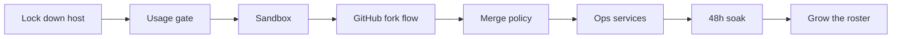

# Build your own AI software company

A practical, tool‑agnostic guide to standing up a role‑based AI coding company like the one
described in the [README](../README.md). Swap any specific tool for your preferred equivalent —
the **patterns** are the point, not the brand names.

> ⚠️ **Safety first.** You are about to let AI agents run with real credentials and open pull
> requests. Do the sandbox and the usage gate **before** you give any agent a token. Never put
> secrets in a repo.

---

## 0. What you need

| Piece | Role | Example options |
|-------|------|-----------------|
| A host | Runs everything | A laptop/desktop with ~16 GB RAM; Linux or Windows + WSL2 |
| An agent CLI | Does the coding | Claude Code, or any agentic coding CLI |
| An orchestrator | Hands out tickets, runs tasks | A self‑hosted agent orchestrator |
| A model proxy *(optional)* | API‑lane models | LiteLLM in front of OpenRouter / other providers |
| A Git host | The agents' only external tool | GitHub (forks + branch protection) |
| A notifier | Tells you when a human is needed | Telegram / Slack / email |

---

## 1. Decide the shape on paper first

- **Lanes.** Which agents run on a flat subscription (cost‑gated) vs a pay‑per‑token API (budget‑capped)?
- **Roster.** Start tiny: **one Engineer**. Add QA, Tech Lead, Security Officer only when each has a job.
- **One config file.** Put names, roles, lanes, models, caps, thresholds, and ports in a single
  `company.yaml` ([template here](../examples/company.yaml)). Treat it as the source of truth.

## 2. Lock down the host before anything runs

- Give the agents their **own OS user**, separate from yours.
- Turn off anything that lets the VM reach your host's files or run host programs.
- Cap the VM's memory so the agents can't starve the rest of the machine.
- Create a **secrets vault** readable only by the ops user (mode `600`). Secrets live **only** there
  (and in your password manager) — never in a repo, never printed.

## 3. Build the usage gate (the money guardrail)

Put a **wrapper** in front of the agent binary so every run is gated. It must **fail closed**.
See [`examples/usage-gate.sh`](../examples/usage-gate.sh) for a teaching version. It should refuse to
run when **any** of these is true:

1. a `HALT` file exists (your big red button),
2. an API key has leaked into the environment (subscription lane must have no paid fallback),
3. usage data is missing or stale,
4. the usage window is at/above your threshold,
5. paid credits moved recently.

Prove it works by trying to break it (set a fake key, create `HALT`, feed stale data) **before** you
wire in a real token.

## 4. Sandbox each agent

- **No web by default**; allow it only for roles that need research, and only to vetted domains.
- **Mask credentials**: inject tokens only on connections to the hosts that need them.
- **Deny reads** of your host credentials, the orchestrator's secret store, and other users' homes.
- Treat all external text (web, issues, PRs) as **data, not instructions**.

## 5. Wire up GitHub safely

- Create a **bot account**. It gets **no write access** to your real repos.
- The bot **forks** the repo and pushes branches to its fork, then opens pull requests upstream.
- Turn on **branch protection** + required CI + code‑owner review on protected paths.
- Keep the human/merge token **minimal** (only the repos and scopes it truly needs).

## 6. Automate merges with a policy (not clicks)

A timer job approves + squash‑merges a bot PR **only** when:

- CI is green and at least one check ran,
- the diff is under a line limit,
- no protected paths changed (CI config, code owners, license, etc.),
- (optional) the linked ticket passed a review stage.

Everything else → leave it for a human and send a notification. If a PR is **behind** main, update it
using the **bot's** credentials (it owns the fork), so your human token can stay minimal.

## 7. Add the ops services

- **Governor**: checks memory/usage on a timer; can pause a lane or HALT everything.
- **Backups**: nightly, plus a snapshot before any risky change. Test a restore.
- **Monitor**: a tiny dashboard + a HALT button.
- **Notifier**: failures, "needs a human" PRs, and merges.

## 8. Run a 48‑hour soak before you trust it

Queue a few **small** real tickets, let the agents work, and watch: tokens per run, memory peaks,
how the usage window moves, and whether the merge policy behaves. Only then grow the roster.

---

## A sane order of operations

**Golden rules**

- Edit the **config**, deploy it — never hand‑edit the running VM.
- Gate and sandbox **before** credentials.
- Start with **one** agent and **one** ticket.
- Keep a **HALT** button you can hit from your phone.

Quick start scaffolding: [`scripts/scaffold.sh`](../scripts/scaffold.sh).
