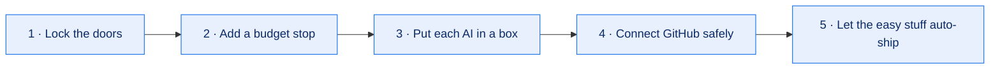

# Build your own (beginner‑friendly)

You don't need to be an expert. Here's the simple version. Swap any tool for one you prefer — the
**idea** is what matters, not the brand names.

> ⚠️ **One golden rule:** set up the "don't overspend" check and the safety sandbox **before** you
> give any AI teammate a real password or key. Never put secrets in a public folder.

---

## What you'll need

- A **laptop or desktop** (about 16 GB of memory is comfortable).
- An **AI coding tool** (anything that can write code and run commands for you).
- A **helper that hands out tasks** to your AI teammates (an "orchestrator").
- A **GitHub account** (the AI's only way to propose changes).
- A **chat app** (Telegram/Slack/email) so it can ping you when it needs a human.

---

## The 5 simple steps

1. **Lock the doors.** Give the AI team its own user account on the machine, separate from yours.
   Keep your passwords and keys in a safe place they can't reach.
2. **Add a budget stop.** Put a small check in front of the AI so it refuses to run when the budget
   is used up or anything looks wrong. (A ready example is
   [`examples/usage-gate.sh`](../examples/usage-gate.sh).) Test that it really stops *before* you add
   any real key.
3. **Put each AI in a box.** No internet unless you allow it. Hide your secrets from it. Treat
   anything it reads from the web as information, never as orders.
4. **Connect GitHub safely.** Make a separate "bot" account with **no access** to your real code.
   It works on a copy (a "fork") and proposes changes; you keep the real keys.
5. **Let the easy stuff auto‑ship.** Small changes that pass the tests can merge on their own.
   Anything bigger or risky waits for you, with a chat ping.

---

## Then: start tiny

- Fill in the blanks in [`company.yaml`](../examples/company.yaml).
- Add **one** AI teammate and **one** small task.
- Watch it work for a day before adding more roles.

Quick start: run `./scripts/scaffold.sh my-ai-company` to create a ready‑made folder you can edit.

---

## Things to remember

- ✅ Edit the **settings file**, not the running machine.
- ✅ Budget stop and sandbox **before** any real key.
- ✅ Start with **one** teammate and **one** task.
- ✅ Keep a **STOP** button you can hit from your phone.

That's really all there is to it. Grow the "company" only when each new role has a clear job.
