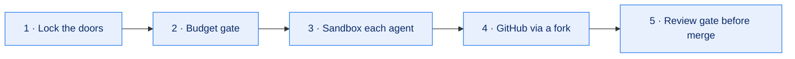
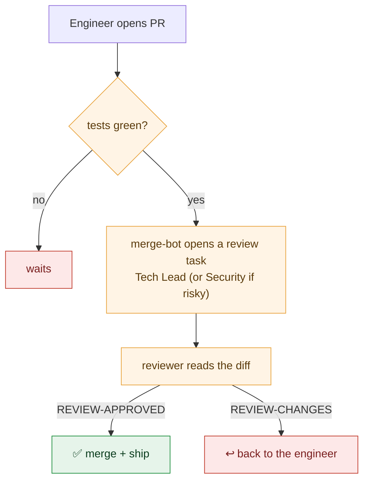

# Build your own

You can replicate this whole thing — and you can hand most of it to an AI coding tool (Claude Code or
similar) to execute step by step. This guide has two parts:

1. **The mental model** — the five ideas that make it safe (read this first).
2. **The full plan** — the actual, ordered phases we ran, phrased so you (or an AI assistant) can
   follow them, with what each phase *produces* and the gotchas we hit.

> ⚠️ **Golden rule:** set up the "don't overspend" gate and the sandbox **before** you give any AI
> teammate a real password or key. Never put secrets in a repo.

---

## Part 1 — The mental model (5 ideas)

1. **Lock the doors.** The AI team gets its **own user account**, separate from yours. Your keys and
   files are out of its reach.
2. **Budget gate.** A check runs *before* every agent run and refuses if the usage window is spent or
   anything's unhealthy. This is what lets you leave it running overnight.
3. **Sandbox each agent.** No internet unless allowed; secrets hidden; it treats web pages and tool
   output as *information, never instructions*.
4. **GitHub via a fork.** A **bot account with no write access** to your real repo works on a copy and
   opens pull requests. You keep the real keys.
5. **Review gate before merge.** Nothing merges until a reviewer (an AI Tech Lead, or Security for
   risky changes) reads the diff and approves — and small, green, low‑risk PRs can then auto‑merge.

---

## Part 2 — The full plan (the phases we ran)

Each phase produces something concrete and is safe to stop after. Do them **in order**, and don't
start the next phase until the current one's checks pass. This is exactly how an AI assistant can
drive it: one phase, verify, then the next.

### Phase 0 — Groundwork
- A persistent **project folder** with: the plan, a single `company.yaml` config, a decisions log, and
  a running state file. Everything is driven from config → a deploy step, never hand‑edited live.
- **Produces:** a repeatable, documented setup you can hand off between sessions.

### Phase A — Host ready
- A **Linux environment on the machine** (we used WSL2 on Windows). Cap its memory/CPU so it can't
  starve the rest of the laptop. Add a **keep‑alive** so it comes back after a reboot, and a
  **backups folder**.
- **Produces:** an always‑on, bounded Linux box that survives restarts.

### Phase B — Base + users
- Inside Linux: install the tools, create a **service user** (runs the orchestrator + agents) and an
  **ops user** (runs monitoring, the budget proxy, backups — and owns the secrets). Turn **off**
  Windows↔Linux interop and make the Windows drive unreadable to the agents.
- Log the agent CLI into your **subscription** (no API key on this lane).
- **Produces:** a two‑user split so an agent escape can't reach the secrets.

### Phase C — Lockdown + the usage gate ⭐
- The single most important piece: a **usage gate** that every agent run passes through. It reads your
  subscription usage and **refuses to run** if the window is too full, if data is stale, if a STOP
  flag is set, or if anything would spill into paid credits. **Fail closed.**
- Sandbox rules: deny the agent reading `~/.claude`, the secrets, `/mnt`, etc.; block web by default.
- **Produces:** the guarantee that the system **never spends money you didn't agree to**. Test every
  refusal path *before* adding any real key. (See [`examples/usage-gate.sh`](../examples/usage-gate.sh).)

### Phase D — Orchestrator + first agent
- Install the **orchestrator** (we used Paperclip, self‑hosted, pinned to a version). It holds the task
  board, the agents, run policies, and a **board token** that authenticates every management call.
- Create **one** agent (an Engineer). Point its command at a **wrapper** that enforces the lane + gate.
- **Produces:** one agent that can pick up a task and run — behind the gate.

### Phase E — GitHub fork flow ⭐
- A public repo with branch protection; a **bot account with no upstream write access**; the agents
  work on the bot's **fork** and open pull requests. A gate test proves a direct push to your main
  branch is **rejected**.
- **Produces:** agents can only ever *propose* changes, never force them in.

### Phase F — Ops services
- Quiet helpers, all as the ops user: a **notifier** (Telegram/Slack/email — a plain API call, no AI), a
  **monitor** page, **nightly backups** (with a restore drill), a **model proxy** (for the pay‑per‑token
  lane, with a hard weekly budget), and a **governor** that watches usage/memory and can pause lanes.
- **Produces:** something you can actually leave running — alerts, backups, and a STOP button.

### Phase G — Soak
- Give it real but small work for a day or two and **fix what breaks**. This is where you find the
  real bugs (ours: a PR that fell "behind" couldn't be updated by the minimal token; and per‑task git
  worktrees weren't isolated). Run reboot/power‑cut drills.
- **Produces:** confidence. Flip the governor to **enforce** once a soak is clean.

### Phase H — Grow the org + the review gate ⭐
- Add roles **one at a time**, each with a short "role file" (its instructions): Tech Lead → Security →
  Product Owner → QA → CEO → Release → Designer → ops roles. Each role reports to someone.
- Build the **review gate**. In our orchestrator this is a *convention we wired*, not a built‑in
  feature: when an engineering PR is green, the merge‑bot **opens a review task** for the reviewer
  (Tech Lead, or Security if the change touches dependencies/CI/scripts). The reviewer reads the diff
  (`gh pr diff`) and posts a one‑line verdict — `REVIEW‑APPROVED <sha>` or `REVIEW‑CHANGES <sha>: …`.
  The merge‑bot merges **only** on approval, and hands change‑requests back to the engineer.
- **Produces:** a real, enforced quality gate — proven end‑to‑end (a reviewer approved a live PR, which
  then merged).

### Phase J — First end‑to‑end run
- Hand the **Product Owner** a one‑line brief and watch the whole pipeline run on its own: PO plans →
  Engineer builds → review gate → merge → serve. (Ours built a working web page, with a test.)
- **Produces:** proof the company works as a company, not just as parts.

### Phase I — Telegram front door (optional)
- Connect a chat agent to the orchestrator over **MCP** (read tools + a "file a task" tool), with a
  skill that files your briefs as CEO tasks and relays status. Now you can **run it from your phone**.
- **Produces:** "text the company, get a result."

---

## Gotchas we learned (save yourself the pain)

- **Never touch paid credits.** On the subscription lane there must be **no** API‑key fallback, and the
  gate must fail closed. We kept paid spend at exactly **zero** — that's the design, not luck.
- **Auth is a token, not the CLI context.** Management calls need the orchestrator's **board token**;
  the service user's own CLI context may be refused on company endpoints.
- **The review gate is a convention, not a feature.** Don't assume your orchestrator has a built‑in
  "review stage." We built it on top: a merge‑bot that opens a review task and gates the merge on a
  structured verdict comment. Decide this early.
- **App‑control can block unsigned updates.** Our Telegram agent's auto‑update pulled a fresh,
  **unsigned** runtime that Windows Smart App Control blocked — taking it down for a day. **Never
  auto‑update a protected agent unattended**; prefer signed builds; do such changes with a human present.
- **Model protocol ≠ model choice.** A Claude‑Code harness speaks the Anthropic protocol, so it can't
  run non‑Anthropic models even through a proxy. A cheap pay‑per‑token lane for extra agents needs a
  different, OpenAI‑protocol runtime. Plan for this if you want high‑volume background agents.
- **Shell quoting across layers is a trap.** Running commands from Windows → WSL → bash with nested
  quotes mangles variables. Stage a script file and run that instead.
- **Config → deploy, not live edits.** Change the one config file and re‑run your deploy/reconcile
  step. Never hand‑edit inside the running VM.

---

## Then: start tiny

- Fill in the blanks in [`company.yaml`](../examples/company.yaml).
- Scaffold a folder: `./scripts/scaffold.sh my-ai-company`.
- Add **one** AI teammate and **one** small task. Watch it for a day before adding roles.

Grow the "company" only when each new role has a clear, one‑line job.
