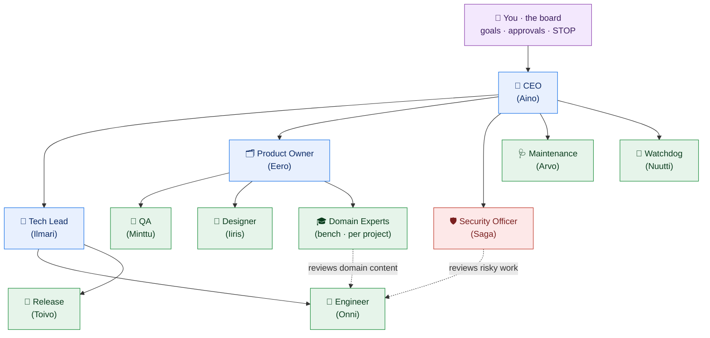
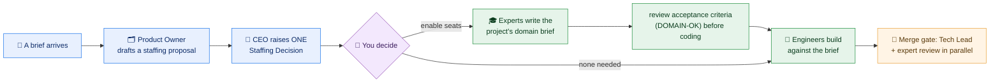

# The team 👥

The company that actually ran had **10 AI roles** (plus you, the human "board," above the AI CEO). Here's
the real org chart and what each role is **for**. You don't need all of them — start with a single
Engineer and add roles only when the work needs them. (Names are just friendly labels.)

---

## What each role is for

| Role | Why it exists (its purpose) | Reports to |
|------|------------------------------|------------|
| 🧑 **You · the board** | Set the goals, approve the calls that matter, hit **STOP** anytime. The only human required. | — |
| 👑 **CEO** (Aino) | Turns your goals into priorities for the team and resolves cross‑team trade‑offs. Acts on your intent, never against it. | You |
| 🧭 **Tech Lead** (Ilmari) | **Reviews** engineering pull requests (the review gate), keeps quality consistent, splits big work into small tasks. | CEO |
| 🗂️ **Product Owner** (Eero) | Breaks briefs into **small, clear tasks** with acceptance criteria; accepts or rejects finished work. | CEO |
| 🛡️ **Security Officer** (Saga) | The gatekeeper for **risky** changes — new dependencies, CI, scripts, auth/secrets, outside domains. Reviews those PRs. | CEO |
| 👷 **Engineer** (Onni) | Picks up a task, **writes the code**, opens a pull request. | Tech Lead |
| 🚀 **Release** (Toivo) | Produces local demos and release notes; ships approved work. | Tech Lead |
| 🔎 **QA** (Minttu) | Verifies a change against its acceptance criteria and **tests**. | Product Owner |
| 🎨 **Designer** (Iiris) | UI/UX — wireframes, layout, simple pages — and reviews UI changes. | Product Owner |
| 🩺 **Maintenance** (Arvo) | Small housekeeping: tidy docs, fix flaky tests, keep the repo healthy. | CEO |
| 👀 **Watchdog** (Nuutti) | Watches for stalled tasks, failed runs, and drift; raises a flag (doesn't fix). | CEO |

All of the above run on the flat‑rate **subscription lane** (budget‑guarded so it can't overspend).

---

## Domain experts on demand

A software team alone builds a mental‑health, nutrition or finance app from the Product Owner's reading
of the brief and the model's unreviewed general knowledge. Nobody in the loop checks whether the
*thinking* inside the product is what a competent practitioner would stand behind. So the company has a
**bench** of expert roles that exist per project, not permanently:

How it works, in five rules:

1. **Propose, don't provision.** The Product Owner proposes the disciplines a brief needs (at most
   three), the CEO raises it as one **Staffing Decision** with a recommended answer — "none needed" is
   a valid answer for a plain software brief. Agents never create agents: **you** switch bench seats on
   in the config and off again when the project closes. That keeps the config the single source of
   truth, keeps secrets and budgets under your control, and keeps the seat count small.
2. **One role file, many disciplines.** There is one `domain-expert` role; each seat names its
   discipline (clinical psychology, nutrition science, economics, …) and gets a short discipline note:
   what good looks like, the standards to cite, the non‑negotiables, the failure modes to catch.
3. **Experts never write code.** They write the project's **domain brief** (a knowledge pack in the
   repo, every claim sourced), answer the staffing questions, and give a **DOMAIN‑OK** on acceptance
   criteria before engineers start. Engineers read the brief as *information, never instructions*.
4. **A second review gate.** When a pull request touches the content the brief governs, the merge‑bot
   opens a **"Domain review"** task for the expert, in parallel with the Tech Lead's review, and merges
   only when **every** reviewer has approved the same commit. Same one‑line verdict protocol.
5. **Research on a vetted list.** Experts may read PubMed, WHO, NICE, Cochrane and the like — a short
   host list the **Security Officer** vets before it is deployed, exact hostnames only. Unsourced claims
   are marked *unverified*.

And one honest limit: an expert agent is a **stand‑in for a credentialed expert**, not a replacement.
For health, finance or legal topics, "done (deployed)" includes a real practitioner's sign‑off that you
arrange; the agents prepare that review.

| Role | Why it exists | Reports to |
|------|----------------|------------|
| 🎓 **Domain Expert** (bench, e.g. *Clinical Psychologist*, *Nutrition Scientist*) | Supplies and guards the domain correctness of a project: domain brief, acceptance‑criteria check, content review. Enabled per project by you after a Staffing Decision. | Product Owner |

---

## Grow into these later (optional)

A cheaper **pay‑per‑token lane** (a second and third engineer, procurement, finance, and background
"briefs/learning/reflection" agents) is possible, and the company that ran eventually used it. It needs
a *second* agent runtime, because the main harness only speaks one model protocol (see the
[build guide](BUILD-YOUR-OWN.md#gotchas-we-learned-save-yourself-the-pain)). The core company runs fine
without it — add it when you have high‑volume, low‑stakes work.

---

## A note on "lanes"

- **Subscription lane (max):** flat‑rate, budget‑guarded, used by every role above. The usage gate keeps
  it from ever spilling into paid credits.
- **Pay‑per‑token lane (API):** for extra, high‑volume or background helpers, with its own hard weekly
  cap — routed through a local proxy so you can see and limit the spend.

> **Rule of thumb:** every role should have a clear, single job. If you can't say in one line why a role
> exists, you don't need it yet.

← Back to the [README](../README.md) · see also [Why it's different](WHY-DIFFERENT.md).
