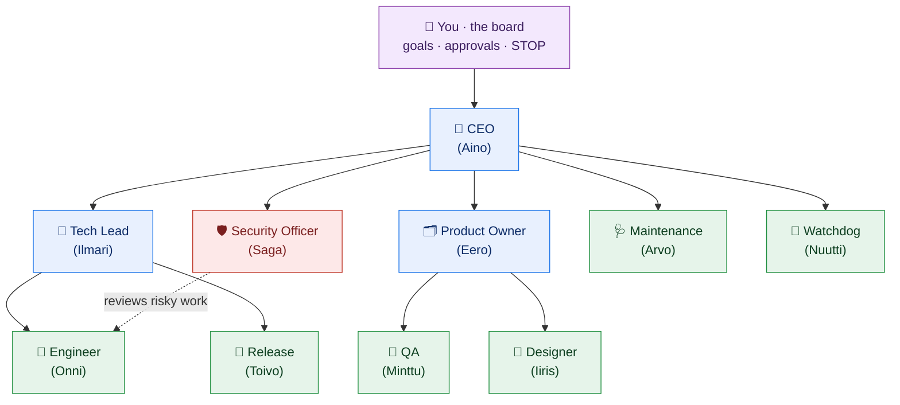

# The team 👥

The company that actually ran had **10 AI roles** (plus you, the human "board," above the AI CEO). Here's
the real org chart and what each role is **for**. You don't need all of them — start with a single
Engineer and add roles only when the work needs them. (Names are just friendly labels.)

---

## What each role is for

| Role | Why it exists (its purpose) | Reports to |
|------|------------------------------|------------|
| 🧑 **You · the board** | Set the goals, approve the calls that matter, hit **STOP** anytime. The only human required. | — |
| 👑 **CEO** (Aino) | Turns your goals into priorities for the team and resolves cross‑team trade‑offs. Acts on your intent, never against it. | You |
| 🧭 **Tech Lead** (Ilmari) | **Reviews** engineering pull requests (the review gate), keeps quality consistent, splits big work into small tasks. | CEO |
| 🗂️ **Product Owner** (Eero) | Breaks briefs into **small, clear tasks** with acceptance criteria; accepts or rejects finished work. | CEO |
| 🛡️ **Security Officer** (Saga) | The gatekeeper for **risky** changes — new dependencies, CI, scripts, auth/secrets, outside domains. Reviews those PRs. | CEO |
| 👷 **Engineer** (Onni) | Picks up a task, **writes the code**, opens a pull request. | Tech Lead |
| 🚀 **Release** (Toivo) | Produces local demos and release notes; ships approved work. | Tech Lead |
| 🔎 **QA** (Minttu) | Verifies a change against its acceptance criteria and **tests**. | Product Owner |
| 🎨 **Designer** (Iiris) | UI/UX — wireframes, layout, simple pages — and reviews UI changes. | Product Owner |
| 🩺 **Maintenance** (Arvo) | Small housekeeping: tidy docs, fix flaky tests, keep the repo healthy. | CEO |
| 👀 **Watchdog** (Nuutti) | Watches for stalled tasks, failed runs, and drift; raises a flag (doesn't fix). | CEO |

All of the above run on the flat‑rate **subscription lane** (budget‑guarded so it can't overspend).

---

## Grow into these later (optional)

These were planned for a cheaper **pay‑per‑token lane** (a second engineer, procurement, finance, and
background "briefs/learning/reflection" agents). They're **deferred** here for a technical reason worth
knowing: the agent runtime only speaks one model protocol, so the cheap lane needs a *different* runtime
(see the [build guide](BUILD-YOUR-OWN.md#gotchas-we-learned-save-yourself-the-pain)). The core company
runs fine without them.

---

## A note on "lanes"

- **Subscription lane (max):** flat‑rate, budget‑guarded, used by every role above. The usage gate keeps
  it from ever spilling into paid credits.
- **Pay‑per‑token lane (API):** for extra, high‑volume or background helpers, with its own hard weekly
  cap — routed through a local proxy so you can see and limit the spend.

> **Rule of thumb:** every role should have a clear, single job. If you can't say in one line why a role
> exists, you don't need it yet.

← Back to the [README](../README.md) · see also [Why it's different](WHY-DIFFERENT.md).
