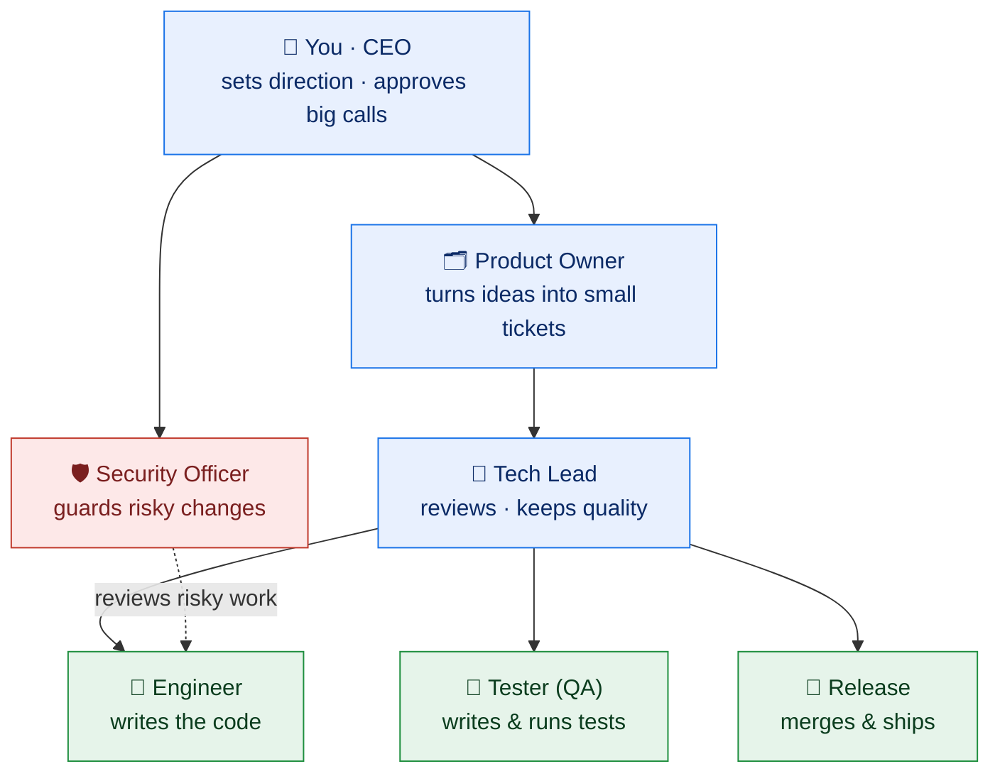

# The team 👥

A quick tour of the "employees" and what each one is **for**. You don't need all of them — start
with a single Engineer and add roles only when the work actually needs them.

---

## What each role is for

| Role | Why it exists (its purpose) | Reports to |
|------|------------------------------|------------|
| 🧑 **CEO / You** | Sets the goals, makes the calls that matter, and can hit **STOP** at any time. The only human required. | — |
| 🗂️ **Product Owner** | Breaks big ideas into **small, clear tickets** the team can actually pick up. Keeps the backlog sane. | CEO |
| 🧭 **Tech Lead** | **Reviews** changes, keeps the code consistent and high‑quality, and splits large work into bite‑size tasks. | Product Owner |
| 🛡️ **Security Officer** | The gatekeeper for anything **risky** — new dependencies, CI changes, logins/secrets, or reaching outside domains. | CEO |
| 👷 **Engineer** | Picks up a ticket, **writes the code**, and opens a pull request. The one doing the typing. | Tech Lead |
| 🔎 **Tester (QA)** | Writes and runs **tests** so a change is safe to ship — catches breakage before you do. | Tech Lead |
| 🚀 **Release** | **Merges** approved changes and ships them, keeping the main branch healthy. | Tech Lead |

---

## Grow into these later (optional)

Add any of these once the basics are humming — not before:

- 🎨 **Designer** — UI and visual work.
- 🩺 **Watchdog / Ops** — keeps the services and the machine healthy, raises alerts.
- 👷 **Second Engineer / Tester on the cheaper API lane** — for running extra work in parallel without touching the subscription budget.
- 📝 **Briefs** — writes short summaries of what shipped.

---

## A note on "lanes"

Most roles run on a flat‑rate **subscription** (budget‑guarded so it can't overspend). Extra
helpers — like a second engineer or tester — can run on a pay‑per‑token **API lane** so they can
work in parallel for a few cents, with their own weekly cap.

> **Rule of thumb:** every role should have a clear, single job. If you can't say in one line why a
> role exists, you don't need it yet.

← Back to the [README](../README.md) · see also [Why it's different](WHY-DIFFERENT.md).
